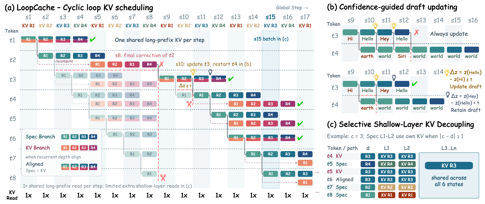

# LoopCache

**Accelerating Long-Context Self-Speculative Decoding for Looped Transformers**

LoopCache uses the intermediate predictions of a looped transformer to draft tokens while the model verifies earlier positions. At long context lengths, it schedules multiple positions against a shared prefix KV cache. The same checkpoint supplies both drafts and verified outputs.



## How it works

1. **Update drafts in flight.** An intermediate loop can propose a replacement for the current draft. The confidence gate compares the logits of the proposed and current tokens. An accepted switch discards the descendants that depended on the old token.
2. **Rotate the prefix KV cache.** At each step, one loop supplies the shared long-prefix cache. The speculative branch can advance immediately. The verification branch advances at matching KV depths, and commits a token once it has completed every loop under the verified prefix.
3. **Decouple selected shallow layers.** A draft can read its own loop’s KV in selected early layers when its loop is sufficiently far from the scheduled depth. The remaining layers keep the shared access pattern.

## Install

Use Linux, Python 3.10 or newer, and a CUDA-enabled PyTorch installation. The inference kernels use Triton, BF16, and CUDA Graphs on NVIDIA GPUs. Run the following command from this checkout.

```bash
python -m pip install -e .
```

## Generate

```bash
loopcache --prompt "The purpose of a KV cache is" --max-new-tokens 32
```

The quick start loads Ouro-1.4B from Hugging Face. To use a downloaded checkpoint, pass its directory with `--model-path`. To select another checkpoint, use the name printed by `loopcache --list-models`. The registry includes Ouro-1.4B and Ouro-2.6B with their Thinking variants, Huginn-3.5B, and the Raven Llama-3.2, OLMo-2, and TinyLlama variants.

### Run the LongBench examples

```bash
loopcache --input examples/longbench.jsonl --batch-size 2 --method 3 --max-new-tokens 32
```

The file contains two complete GovReport contexts by Huang et al. (2021), paired with a short summarization prompt and identified by their original LongBench IDs. [LongBench dataset](https://huggingface.co/datasets/zai-org/LongBench) · [GovReport](https://gov-report-data.github.io/) · [GovReport data license (CC BY 4.0)](https://creativecommons.org/licenses/by/4.0/)

Each request produces one JSON line with its ID, prompt length, generated token IDs, decoded text, and elapsed decode time for the batch. Use `--batch-size 1` to run the same requests individually.

LoopCache first tries to fit the requested batch on one GPU. If the batch exceeds capacity, requests that fit individually can run in smaller batches. Only sequences that exceed single-GPU capacity use multiple GPUs. The output records the GPU count and actual batch size for each request.

For your own inputs, supply a JSONL file with a `prompt` string or an `input_ids` list on each line. An optional `id` is carried through to the output. Plain text is tokenized as supplied. Generation uses greedy decoding and stops at EOS or the requested budget.

### Select a method

| Option | Decoder |
| --- | --- |
| `--method auto` | Select a schedule using the prompt length. |
| `--method 1` | Update drafts as tokens advance through recurrent loops. |
| `--method 2` | Add cyclic KV scheduling and a separate verification branch. |
| `--method 3` | Add selective shallow-layer KV access to the cyclic schedule. |

To measure decode time at a fixed output length, pass `--fixed-tokens --max-new-tokens 256`. The `batch_decode_seconds` field measures the decode loop after prefill and graph capture. All rows with the same `batch_index` share one timing measurement. Run `loopcache --help` for the full command interface.

For the paper’s shallow-layer setting, use `--method 3 --confidence-margin 0.125 --shallow-layers 2 --loop-gap 1`. Vary one argument at a time to sweep the confidence threshold or the number of independent layers.

## Citation

Please consider citing our work if you find the code or project useful.

```bibtex
@inproceedings{Fu2026LoopCacheAL,
  title={LoopCache: Accelerating Long-Context Self-Speculative Decoding for Looped Transformers},
  author={Zi-Zhuo Fu and Hao-Chen Huang and Sheng-Xuan Qiu and Lin-Ye Wei and Zi-Yu Tang and Run-Sheng Wang and Meng Li},
  year={2026}
}
```
